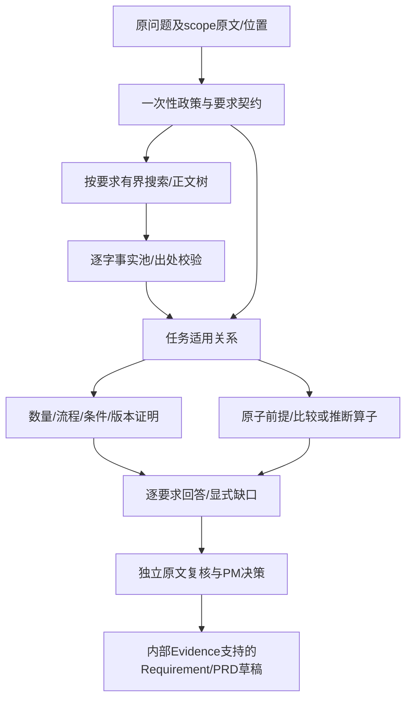

# Phase8统一证据契约：现场、需求映射、设计与实施计划

> **2026-10-18执行状态更新：** 本设计已分批实施，当前进展及剩余失败见[47号交接](47-Phase8当前进展痛点与新对话交接.md)和[48号续接Prompt](48-Phase8新对话续接与搜索替代方案Prompt.md)。用户最新授权由Codex亲手修改，不再让Claude写代码；下方“尚未实施/原Claude线程”保留为设计时历史描述。Phase8仍PARTIAL，不提交、不push。

日期：2026-10-17；负责人：三文鱼；执行：Codex Supervisor。**这是第一批设计交付，尚未实施v7。Phase8仍PARTIAL、Research质量FAIL，无暂存/提交/push。** 43号根因更正和44号预算/协作/保护/最终验收约束全部有效。

> 执行方式：按 executing-plans 逐批实施，由Codex独立验证后续接原Claude线程。用户已授权设计汇报后实施，无需新增“是否继续”审批；禁止按技能默认逐任务提交、创建新Worker线程或改变工作树。

**目标：** 交付回答原问题、能追到适用原文的竞品能力/设计/限制/差异、样本模式、场景优缺点及机会风险；保持PM决策权，修复下游已知风险的支持缺口。完成数、摘录数、非空数组不作为业务验收。

**架构：** 一份稳定要求契约，独立原文事实池，受约束支持关系，确定性回答组装。模型提结构候选，服务器验证可机械验证的关系，Codex独立逐条原文复核语义；不把结构验证包装成开放域蕴含证明。

## 1. 第一批现场与证据边界

本轮现场：HEAD `449e8790b8da8b9f04f4e3739cd9740606241cc4`，分支`codex/phase6-evaluation`，index空。26份final4产品指纹、118份归档证据SHA256全部一致。另冻结243份源码/测试/迁移/数据/保护文件到本机work；前后比较未变。0015为文件迁移head，不代表用户运行库revision。`--check-config`为`CONFIG_PRESENT_NOT_CALL_TESTED`，未输出配置值。

本轮离线重放43号脚本成功；既有五份相关测试80项通过（1.29秒）。这证明缺陷在当前代码可重现及旧回归仍绿，**不证明修复、全量工程、真实Research或浏览器通过**。当前尚未重新调用模型/搜索、连接用户库或启动验收服务。

MCP账本66个历史job全部done；最后两个仍为d7d73d0ca37f4e9a988cae6732989573、74c5670abe6a4f81931faec3cf6c2a85。现场另有交互式Claude PID62936，cwd为本项目、状态S+，非MCP批任务；未发现本轮243文件变化，不擅自终止。写入批次启动前再次核对文件漂移、活动MCP job及该进程状态；“进程存在”和“有活动写入”分别记录，不能凭历史done宣称没有其他Claude进程。

18080/13080当前未监听；8000属于另一项目AI小商。两套用户PG进程仍在work/local-postgres和work/phase7-user-postgres，本轮不连接、不重启、不改权限，revision/行数NOT MEASURED。后续破坏性测试只用全新临时PG。

本机证据：`work/phase8-supervision/20261017-design-v7/`中的site-audit、baseline-file-manifest、git-status/diff/log、scoped-baseline和replay/replay-results。公开副本见[evaluations/phase8-v7-design](evaluations/phase8-v7-design/README.md)。旧42号完整工程/真实调用数字只作历史，不转换成本轮成绩。

## 2. 原需求→现有实现→实际证据→缺口→处理范围

状态含义：已实现≠本轮已验证；历史实测单列；未测不得标PASS。

| 原需求及出处 | 现有实现 | 实际证据 | 缺口 | 本轮处理范围 |
|---|---|---|---|---|
| V1§9、Sprint1§9—10：输入/Raw分离 | CSV导入、feedbacks/analyses分表 | 当前API/模型；42号Raw12行9字段审计 | XLSX/字段映射未实现；300+/500条非本轮成绩 | 回归Raw全字段；不扩做导入功能 |
| V1§10—19、Sprint1§11—17：分类/语义聚类/洞察证据 | 分类、pgvector、Insight/Evidence与Run | 当前服务/历史链路 | 真语义Embedding未验收、split_partition及正式人工语义复核未闭合 | 真实新链路起点；保留历史限制，不重写Phase1—3 |
| V1§20—22：评分和PM主导 | 确定性分数、BV、accept/override等事件 | 当前评分服务；42号测试PM操作 | 正式业务评分标签未审核 | 回归PM快照/优先级不被AI覆盖 |
| 总纲§81—82、原任务4—12：竞品能力、设计、限制、差异 | v6任务/来源/事实/覆盖和详情UI | 当前代码；本轮重放R1—R5 | 逐句数量自阻断、候选丢答案、政策混条件、analysis/comparison/version不足 | 统一要求/作用域/支持图及直接回答 |
| 原任务4/6：样本模式、场景优缺点、机会风险 | v6已有4类分析及0015支持字段 | 42号真实浏览器5条；本轮绑定复核 | Windows误收、per-item标题、Google自动备份前提缺绑定 | 原子前提与派生算子；有依据正例必须实际可生成 |
| 原任务7—10：来源/引用/版本/事实推断区分 | 官方正文、ID、offset/length、精确引文 | 本轮26指纹及80回归；冻结官方快照 | 真实与相关性混在status，旧schema/runtime不一致 | 保留旧守卫，新版分层状态和统一schema来源 |
| 原任务5/25—27：有限上下文/追踪/评测 | 内部有界摘要、tokens/metadata/trace | 当前pipeline/client、冻结18题 | 候选坏字段、最终采用轮次、支持原因缺失 | 闭式安全诊断、预算账本和逐层漏斗 |
| V1§23—25、原任务3/21/36：研究后需求/PRD | PM参考Research后生成内部Evidence草稿 | 42号真实链路，首次PRD503后201 | known风险ID合法但不支持审核/后端原因 | 最小下游支持校验，新Prompt；不混Raw与外部URL，不改评分 |
| V1§32—34、总纲§68—72：Evaluation | 确定性指标及NULL语义指标 | 当前模块、历史报告 | Artifact/长期质量未测 | 独立Rubric结果落证据；不伪造自动质量百分比 |
| 原任务13—20/29/31：Tool/人工审批 | 静态Registry、Prepare/Cancel/Approve、SIM审计 | 42号历史PG并发/浏览器 | 真实外部写入未接 | 保留并最终重验；真实Jira/Notion/飞书/MCP DEFERRED |
| 原任务21—26/41：可选多Agent | 无通用编排 | 当前代码 | 非必需 | DEFERRED，不为技术名称扩做 |
| 原任务32—36：降级/隔离/核心链 | 研究失败不替代内部Evidence，项目404 | 当前API/页面；42号历史 | 本轮未重验；不等于身份认证 | 最终生产浏览器、跨项目、真实完整链重验 |
| 总纲§84、原任务44：部署/鉴权 | 本地单用户服务 | 当前配置 | 未做RBAC/云部署 | Phase9，超范围 |
| 总纲Gate、原任务39：正式验收/Git | 大量未提交Phase8工作 | 本轮Git现场 | Research仍FAIL；用户未签 | 全部门槛齐才精确暂存本地提交，禁止push，不代签 |

## 3. 已复现根因及修复义务

| 根因 | 本轮实际证据 | 处理义务/反例 |
|---|---|---|
| R1 真伪/数量混层 | 相同OneDrive三步：原#3全部multi_select_quantifier_missing；原#8全部confirmed | 原文事实不因问法变假；整组多选断言仍须独立明确数量，不以files/photos复数代替 |
| R2 多套问题解析 | Using only被重新列unresolved；iPhone→iOS报task_subject_not_in_question；analysis无完成分支、version固定false | 原文span和规范化概念分开；来源政策仅编译一次；显式条件不得丢；实现类型化覆盖，不以kind本身固定失败 |
| R3 候选取舍 | #9第二轮(false,0,7,0)，第三轮(false,0,6,0)；第三轮含手机三选项和Shared入口，最终选回第二轮 | 稳定要求ID和按要求保存支持；不得按摘录数回退，不无条件并全部重试 |
| R4 查询语义流失 | 中文分析scanner为平台[]、动作[photos]；实际google photos photos site:support.google.com | 查询继承计划中的原动作/对象/平台片段及有来源的译词；不从有限动作词表重建 |
| R5 真引文错任务 | Windows视频限制仅识别app，仍confirmed | 正文分支作用域和需求绑定检查必须作用于所有交付事实；旁支真实材料留候选，不当回答 |
| R6 ID图不等于充分支持 | 样本模式绑定6条均无Google自动备份句 | 每个事实前提单独支持；标题/正文/场景同一生成来源；推断不能借not_verified免责 |
| R7 协议失败 | 冻结英文分析第1轮、中文第3轮缺工具块 | 分类记录；小契约真实对照；供应商/载荷因果仍待验证，不解析thinking/任意text JSON |
| R8 schema/runtime | scenario公开500/runtime200，300字符确定性失败 | 新版单一契约生成wire/runtime，测试199/200/201及完整payload；旧Prompt不改 |
| R9 诊断不全 | 未存tasks候选；best来自旧轮但last_code末轮 | 安全字段路径、允许ID、采用/拒绝原因、所用轮次分别保存；不扩大敏感日志 |
| R10 下游语义 | F001/F003只证明单选，known审核/后端原因仍被接受 | 真实known正例保留；没有原因证据的模型known拒绝或明确待验证，不能自动全部改speculative |

## 4. 架构比较和选择

| 选项 | 能解决什么 | 不能接受的代价 | 结论 |
|---|---|---|---|
| 继续在v6各层加正则/产品词 | 局部问法 | 多套解释仍冲突；R1/R3/R6不消除 | 不选作主架构 |
| 独立模型重判“完整/支持” | 可提出批评 | 额外调用超预算；模型仍不能签完整性；双模型不等于证明 | 不作门槛 |
| 稳定要求＋独立事实池＋类型化支持＋回答组装 | 分开真实性/相关性/数量/分析，跨轮保留有用支持 | 需要明确有限可验证算子；开放语义仍独立审核 | **选定** |

不是把“语义”全部交给正则，也不声称模型任务候选已证明理解正确。服务器验证结构、原文位置、类型、范围和可检查关系；原问题理解、开放域结论的充分性最终仍由独立原文Rubric判断。计划遗漏或误解要记录为功能失败，不能借“未验证”全面拒绝而算交付。

### 4.1 每层职责和状态

1. **QuestionSpec**：保存question/scope原文及哈希；半开区间`[start,end)`；PolicySpan和RequirementSpan互不偷换。每个要求有稳定ID、原文锚点、产品/设备/OS/入口/操作/对象、条件、数量、版本和输出facet。规范化术语是检索/关系候选，不是证据；iPhone设备和iOS系统分别表示，不能因此外推所有版本。未解释的业务子句保持unresolved。来源指令由服务器匹配既有白名单，模型无权添加host/path。
2. **SourcePolicy**：决定允许搜索/读取/引用哪些来源，记录策略span；不要求业务原文“证明只引用官方”。未知来源要求保留policy_unknown；不能误当离线/订阅等业务条件。
3. **Snapshot/DocumentNode**：来源URL、ID、抓取时间、哈希、标题层级、父子列表、平台分支、条件Note的范围；分支继承只沿父链到同一合法流程，兄弟平台和同页旁支不可互借。取不到结构时保留unknown，不从URL域名猜任务相关。长条件用有序、同快照、相邻且覆盖完整条件的≤200字符片段集合；不拼改原文，不截掉版本/否定。
4. **QuotedFact**：仅保存服务器从快照提取的逐字文本。原来源ID/URL/官方边界/名称/offset/引文外扩写/否定守卫保持；内容由代码生成，模型不得写fact标题或事实描述。事实有`provenance`和独立`applicability`，只有出处合法且至少一项要求适用才进入交付confirmed事实。Windows/动画等真实旁支留在内部候选诊断，不进入回答及支持集合。
5. **SupportEdge**：要求ID→本Run事实ID，携带范围/flow/条件作用域和谓词类型。`procedure`需同一流程全部必需步骤和所问分支；`quantity=multiple`需同流程明确数量动作原文；普通复数不证明一次多选；`version`需具体原文版本和对应约束，区分“最低版本”与“受影响版本”；条件必须关联该流程，不能借另一个未解析条件。未知版本不能硬false，也不能凭问题自己有数字即过。
6. **Comparison/Analysis**：一般比较按同一facet的两侧关系计算，不限手动vs自动。分析任务包含请求的产物义务，不因kind=analysis固定失败。每个分析前提引用已验证SupportEdge，范围一致；派生形式为`contrast/shared_pattern/scenario_tradeoff/proposed_test`等有限算子。样本模式须≥2产品、同维度且只称本样本；机会/风险是提案或假设，不升级confirmed、不替PM判断。
7. **Answer**：按原要求顺序返回已证实窄结论、步骤/选项/条件/版本、差异及未验证项，并显示事实/推断/建议。事实句由逐字引用和受限关系模板组成；自由文本不得给标题补未支持能力。分析的自由提案文字显式是待验证建议，不能承担事实前提。原问题覆盖、机器可检验支持、人工语义结论三者分开；completed不表示用户已签。

### 4.2 跨轮支持保留，替代best摘录数量排名

契约冻结后才取证；要求ID不可在纠错中改写/删除。`SupportLedger[requirement_id]`保存通过谓词的支持组、来源快照、flow/平台/版本、产生attempt及缺口。新候选只补缺失关系或给出显式替换；同范围无矛盾的独立要求可组合，完整流程必须整体校验，禁止把两套残缺流程拼成完整。

同一要求有矛盾、不同版本/平台或不同快照时保留冲突组，相关要求partial，不把两边自动并集。无关事实数量、分析数量不参与排序。可比较的是同一冻结要求集合的覆盖向量；向量相等保留已有合法支持，额外分析只独立增加合法分析，不能替换事实。总最终选择也≤40；超过则报告预算缺口，不能靠跨轮并集隐性扩到120。

#9失败夹具的验收结果：第三轮两项关键支持保留；第二轮Shared既有内容移动不挤掉它们。若契约/版本仍失败，能交付关键局部回答并准确列缺口，不能谎称整题成功。

### 4.3 分析与PRD支持边界

模型不能输出任意事实叙述再仅附ID。分析候选分为：`premises`（extractive事实/类型化关系）、`operator`、`scenario`（来自问题/内部已标注场景）、`proposal`、`limitations`。title/事实前提由服务器组装，避免per-item标题与多选原文矛盾。请求手动/自动并存模式时，两个产品必须各自绑定手动和自动前提；Google自动句虽然在页面存在，未绑定就不能通过。机械支持之外的推断合理性继续逐条独立审查，不声称程序证明开放语义。

最小下游修复：新AI生成契约为known风险要求可回到输入Raw的精确支持片段；known描述采用这些原文，不允许在描述里添加未有证据的原因。建议/缓解措施仍是提案；speculative保留假设标签和独立待验证问题。F001/F003不能支持审核/网络/后端策略归因；真实Raw若明确说明已达到上传大小限制，则可形成已知限制正例。不能把所有风险自动改speculative，也不能要求全部风险必须已知。

旧Requirement/PRD不回写、不自动修类别；旧known没有新支持元数据时显示“历史内容，语义支持未复核”。PM手工内容可保存既有结构，但未验证支持不得展示为程序已核对。新的AI生成路径严格校验；编辑/Accept不由AI自动执行。其他章节仍要独立审阅，新增known守卫不被描述为全文语义证明。

本批不自动将Research塞进PRD输入：PM参考独立外部研究后决策，PRD继续使用内部Evidence。若后续需要显式引用外部研究，须独立来源类型/Run范围设计，不伪装Fxxx，不作为此轮最小修复偷偷加入。

## 5. 预算与调用编排（原上限不变）

选择“第1次规划→第2次选证/关系候选→第3次只做有界纠错或补充分析”。分析可从通过的类型化关系确定性生成；不得在第3次后另叫评审模型。若规划协议失败，第2次只纠正规划，第3次用于取证候选；分析不足如实partial。若证据候选失败，第3次优先修必要事实，剩余分析缺口公开，不能假装完整。

| 资源 | 总上限/策略 |
|---|---|
| 实际LLM请求 | ≤3，规划、协议失败、传输后不确定结果、纠错/分析都计入；dispatch前先扣预算；无隐藏客户端生成重试 |
| 逻辑搜索 | ≤3；两产品初始分配各1，剩余1按未满足要求；同查询传输重试沿既有上限单列，不作新逻辑搜索 |
| 正文与来源 | 读取尝试≤5、持久来源≤5；两产品先各2页，最后1页给关键缺口；失败读取也占尝试，URL去重不能多拿正文 |
| 证据单元 | Run累计提供≤100，首次最多60、为补缺保留40；按要求/分支轮转分配；已给单元计入累计，即使后轮不再发送也不释放 |
| 选择 | 每请求及最终交付事实总集合≤40；条件/作用域支持片段也计数，不能另藏不计费事实池 |
| 分析候选/要求 | 分析≤8、要求≤16，超出保留未解析/预算缺口，不悄悄截断要求后completed |
| 原文引用 | 单片段≤200；长条件用有序精确集合，全部片段计入100/40 |
| 读取安全 | 既有官方白名单、逐跳HTTPS/无userinfo/默认端口，3跳、10秒、解压4MiB、文本24000不变 |
| schema及输出 | 新版scenario统一200；事实/支持以ID/闭式枚举为主，去掉重复4000字snippet；max_tokens不超过现有8192，具体实际usage逐次记录 |

调用#1不带来源答案，只携带原问题及有界内部context；输出锚定要求、查询候选及原文动作/对象的翻译。译词只用于搜索，原文动作必须在query保留；不再用_scan_semantic_terms删到photos。服务器注入白名单site。步骤集/条件已在catalog却未选，不再花搜索；缺页才补搜。每次停止记录`budget_exhausted/selection_gap/source_gap/protocol_failure/unsupported_relation`。

预算不能完成的题记功能/执行缺口，不把总LLM提高到4或每要求各3。费用无可信价格不估算，unknown usage单列；协议载荷因果对照用分别有唯一Run的旧/新合同请求，单Run≤3，不将诊断调用藏在真实题集之外或用最好轮覆盖失败。

## 6. 兼容和持久化决定

**当前不新增迁移。** 0014的task_contract/coverage_report/execution_trace及0015的claim_kind/supporting_finding_ids/evidence_location可以保存契约、回答和支持元数据；Requirement/PRD风险是已有JSON。新结构均有version discriminator，旧NULL/v5/v6不回填，不强套新含义。

Research请求已有prompt_version，但当前API未传入service。本轮用明确的版本注册表支持v6/v7；未知版本422，不能动态导入模型指定模块。为保护旧客户端和固定v6回归，无version保留v6语义；新版正式页面及本轮v7验收**显式发送research-agent-v7**。旧v6路径标历史契约且保留质量限制，不冒称旧调用已经自动修复；没有测试环境探测分支。脚本同时记录所选版本，原QUESTIONS文本和分母不动。

所有新版Prompt均新文件；v1—v6保留原字节。旧直接函数及v6回归保留，不为绿色修改历史负例。公开Read DTO可新增optional typed视图（answer/support），来源仍原API；旧dict/NULL兼容。业务支持不能只藏diagnostic trace：回答放coverage_report.answer，事实/分析支持放evidence_location中带version的业务结构，API形成明确可空Read模型。

Requirement/PRD风险新增支持字段为optional；新Prompt wire强制known支持，新AI runtime强制，旧GET/PM旧结构保持可读可编辑并给未核对警告。若实际实现发现JSON不能承载/查询必须独立索引，先记录证据再单独评审0016，未评审禁止创建或改0015。

## 7. 精确批次和文件许可

下列是监督计划范围，**不是一次性给Worker的全列表授权**。每job只含一批允许文件，测试由Codex执行；旧源码/测试默认保护。修改已存在文件须相对本轮baseline审阅，不能相对HEAD误覆盖既有Phase8工作。

### A 已完成：现场、复现、设计

- [x] 按AGENTS、43/42/44和规范/PRD/原任务/历史报告读取并核对冲突。
- [x] Git/指纹/迁移/配置/Worker及实际进程核对，离线重放和80项既有行为基线。
- [x] 本文需求映射、架构选择、预算、兼容、用例、批次和验收门槛落盘并向三文鱼汇报。

### B 待实施：纯契约和正文关系（不切换活跃链路）

允许新建：`backend/app/services/research_spec_v7.py`、`backend/app/services/research_support_v7.py`、`backend/tests/test_phase8_spec_v7_supervisor.py`、`backend/tests/test_phase8_support_v7_supervisor.py`。必要只读复用research_contract/reader/selection；本批不改旧文件。

- [ ] 先写R1/R2/R3/R5/R8失败行为用例，Codex运行确认红；Worker再实施。
- [ ] 定义统一闭式QuestionSpec、DocumentScope、SupportLedger和schema边界；纯函数校验span/预算/跨Run范围；要求ID冻结、只补支持。
- [ ] 同一官方步骤的真实性不受整题多选影响，多选证明只在相关SupportEdge；一般比较/版本/分析有明确类型化义务。
- [ ] Codex独立检查正反例和全部原严格守卫入口，没有新事实描述自由扩写。

出口：新纯函数正反例通过；单靠span/模型宣称不被当作语义证明。失败证据续原Research线程，不派前端。

### C 待实施：有界v7执行、引用、候选保留及诊断

允许新建：`backend/app/services/research_pipeline_v7.py`、`backend/app/agents/prompts/research_agent_v7.py`、`backend/tests/test_phase8_pipeline_v7_supervisor.py`；必要修改：`research_client.py`（统一安全协议边界）、`research_service.py`（显式版本路由）、`backend/app/api/research.py`（传version/typed Read）、`backend/app/schemas/research.py`（可空新视图）。只在正文父子结构确实缺失时放行`research_reader.py`/`research_selection.py`，保留旧输出行为，不改历史Prompt/迁移。

- [ ] 先测预算扣减、协议缺块、未知ID、候选回退、中文动作及各层漏斗失败；再接执行。
- [ ] 按5节编排，保留按要求验证过的支持，最终≤40；候选冲突不合并；#9关键答案保留。
- [ ] 错误保存phase/schema_version/field_path/允许ID/first_failed_guard/adopted_attempt及per_requirement attempts；最后失败和最终采用结果分开。
- [ ] 所有异常诊断仅闭式值/长度/合法ID，不保存thinking、任意响应text/body、headers或密钥。

出口：完整新路径HTTP/DB合成证据回归通过；旧v6全部回归不变；真实小契约对照只归为执行证据，不预签质量。

### D 待实施：分析、回答和必要下游

允许新建：`backend/app/services/research_answer_v7.py`、`backend/app/services/artifact_support.py`、`backend/app/agents/prompts/requirement_generation_v2.py`、`backend/app/agents/prompts/prd_generation_v4.py`、`backend/tests/test_phase8_answer_v7_supervisor.py`、`backend/tests/test_phase8_artifact_support_supervisor.py`；必要修改：`requirement_prd.py`、`requirement_prd_client.py`、`backend/app/schemas/requirement_prd.py`及B/C新版模块。

- [ ] 先拒绝“有ID缺前提”、Windows移动端、per-item错标题、原因无证据known风险；同时保留有完整支持的模式/优缺点/机会/风险和真实known正例。
- [ ] 事实前提逐项绑定；分析从类型化关系产生，提案和假设显式待验证；直接回答原要求。
- [ ] 下游新生成强制支持；旧数据读回不变，不改PM状态机/评分/Raw；不把Research URL混入Fxxx。

出口：不能只断言数组非空；对每个输出事实前提、来源和假设边界审查。下游协议失败路径分类保留，原有重试预算不扩大。

### E 待实施：生产页面接线

只允许：`frontend/src/lib/api/types.ts`、`client.ts`（如必要）、`frontend/src/app/insights/[id]/page.tsx`；必要新建`frontend/src/components/research/ResearchAnswer.tsx`及独立`.test.tsx`。仅风险支持显示需要时再放行Requirement/PRD实际页面。已有测试不删改；新版数据用新测试。

- [ ] 新提交显式选v7；显示实际回答、条件/缺口、事实/推断/建议及分析→前提→事实→来源。
- [ ] 不展示内部schema诊断/模型自评分；保留“回答完整性：未验证”、历史旧契约提示。
- [ ] project/Run切换清理回答和展开状态，过期异步响应不可污染项目B。

出口：lint/test/build后生产浏览器真实请求v7，不能使用Mock证明业务能力。

### F 待实施：最后代码完整验收与交付

允许：`backend/scripts/verify_phase8_research_live.py`只加显式版本/采集参数不改QUESTIONS；新建独立验收脚本及夹具、文档、证据账本（具体脚本执行前由Codex复核）；更新工作记录、08/09、入口、33人工流程及新交付报告。Tool默认不改。

- [ ] 后端SQLite全量、全新临时PG全量及upgrade/check→downgrade base→upgrade/check、Ruff。
- [ ] 前端lint/test/build；生产Next＋真实FastAPI＋临时PG的Research、支持/来源、覆盖和跨项目404。
- [ ] 原十题逐条真实调用及官方原文独立核对；新增中文/改写/分析8题另列。稳定性声称前同最终代码同集复验并公开差异，不挑最好轮。
- [ ] 新建反馈→真实分类/聚类/Insight→Research/来源→测试PM→真实AI Requirement→真实AI PRD；全章审核，不能预造approved替代。
- [ ] 模拟Prepare→Cancel无目标→再Prepare→Approve→重复Approve同SIM且单目标；再Prepare后approved→archived→Approve409无新增。跨项目读/写404。
- [ ] Raw按ID对齐全字段比较，仅时区统一UTC后比同一时刻，不丢列；全部保护文件SHA相同；关闭自己创建服务，用户服务不动。
- [ ] 工程、业务、真实质量、链路、审批隔离、文档全部通过才Codex逐文件精确暂存并本地提交；否则PARTIAL、不提交，保留失败证据。

## 8. 失败夹具和验收判据

夹具来源是冻结的公开官方正文，不把旧模型答案当黄金标签；另加异产品/改写留出集，禁止原题答案进入生产Prompt。下列均需行为断言和本轮红绿记录。

| 用例 | 必须观察到的结果 |
|---|---|
| 同一OneDrive开App/Choose Existing/Done，单张与多张问法 | 原文真实性一致；只有具有同流程明确数量证据的组可证明多选 |
| 仅普通files/photos、格式multiple、workaround/iOS16 | 不证明任意入口一次多图上传；不得跨范围升级 |
| #6手动四步＋独立自动句、删自动句 | 前者可交付区别；后者保留区别缺口，不以roaming替代 |
| #7禁用camera uploads＋完整八步、删第3步/禁用句 | 完整正例可答；缺任一义务不得completed，内部双引号逐字保留 |
| #8已有图片与拍照兄弟分支 | 只交付所问分支；拍照/HEIF导航不作为支持 |
| #9 attempt2七条旁支 vs attempt3六条含关键手机/Shared句 | 按要求保留第三轮关键支持；加100条无关摘录也不能改变核心答案 |
| 同要求两个平台/版本/矛盾来源 | 保留冲突及版本，不任意并集 |
| Using only/Cite only/中文仅引用 | 仅影响来源政策；加offline/disabled应增加业务义务，不能被删除 |
| analysis、一般两产品comparison、最低版本询问 | 有支持正例能够形成真实产物；缺前提明确partial，不固定false |
| 中文手动添加/移动端/照片及同义改写 | 查询保留原动作/对象/平台；动画/电脑/overnight不能替代 |
| Windows视频真句＋移动端照片任务 | 原文出处可真、任务适用失败；不进入回答或分析支持 |
| 两产品模式绑定缺Google自动前提 | 拒绝该模式或缺项；补入确切同Run前提后允许，不靠页面“存在” |
| 标题per-item但支持为多项长按 | 不生成该标题；title来自验证关系，不能自由扩写 |
| scenario199/200/201，wire→真实parser→materializer | 前两者同意接受，201统一拒绝，字段路径明确；不出现500/200错位 |
| 缺工具块/错工具/额外字段/未知ID/坏bindings | 有界错误分类、计入3次、保存安全路径；不挖text JSON |
| 第3次协议失败但第2次有合法局部支持 | 局部支持保留，selected_attempt与last_failure分别准确 |
| known引用F001/F003却归因审核/后端 | 新AI生成拒绝；Raw明确同一限制/原因的known正例可通过；旧行标未复核 |
| 跨Run/项目/未确认/循环支持 | 全部拒绝，关系不通过ID存在即放行 |
| 搜索4/正文6/提供101/最终选择41/LLM4 | 调用前阻止、明确预算耗尽；不隐藏重试 |
| v6旧Run、NULL字段、旧PM风险编辑 | 原内容不回写、不崩溃、不伪装已新验收 |

## 9. 最终Gate与当前判断

| 门槛 | 通过标准 | 当前 |
|---|---|---|
| 现场与设计 | 基线/证据可重放；需求、职责、预算、文件与用例明确 | 本文第一批完成 |
| 工程 | 最终源码全部回归、PG往返、lint/build实际通过 | 本轮仅80项旧专项通过；全量NOT MEASURED |
| 功能 | 能答已知有证据正例；一般比较/分析/版本不被固定拒绝 | FAIL，未实施 |
| 真实质量 | 原十题保持分母；全部确认事实/相关性/完整性和分析前提独立审核；未验证诚实且无捏造 | 仍沿用42号FAIL；本轮真实调用NOT MEASURED |
| 完整链路 | 真Research→PM→真AI Requirement/PRD，内容逐章核对 | 本轮NOT MEASURED |
| 审批/隔离/Raw | 真实浏览器/API/新PG及全字段审计 | 本轮NOT MEASURED |
| 文档/Git | 保护/脱敏/账本完整，所有前置门通过才本地提交 | 不暂存、不提交、不push |
| 正式验收 | 仅三文鱼本人签署 | 未签，不代签 |

完整/局部/未验证的分母以题为单位；引文事实错误、任务相关性误收、整题完整性误报、分析前提不足分别计数。真缺证据允许诚实未验证；有官方答案却未交付是执行/功能失败，不能改成“官方没有资料”，不能强造10/10。没有本轮最终证据不写PASS。

Phase2真实语义Embedding、Phase3正式人工复核、Phase4业务评分、Phase6 Artifact/长期质量、Phase7稳定性及人工验收限制全部保留。真实外部集成DEFERRED，SIM仅模拟。完成或失败交付都STOP于Phase8，不进入Phase9。
